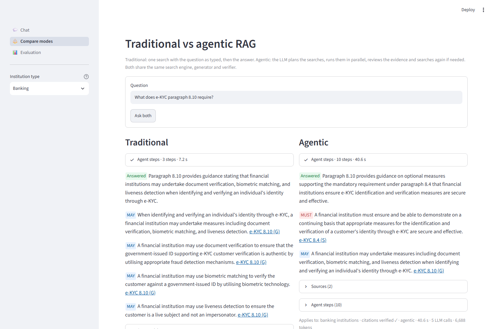

# Bank Policy Compliance Assistant: agentic RAG over BNM policy documents

An assistant for bank compliance staff that answers questions **only** from three
Bank Negara Malaysia policy documents: **e-KYC**, **Fair Treatment of Financial
Consumers (FTFC)** and **AML/CFT/CPF & TFS for Financial Institutions**. It cites
every statement to its paragraph and page, labels each one as an obligation
(**MUST**: an S paragraph, or an unmarked appendix or table rule such as the FAR
thresholds) or guidance (**MAY**: a G paragraph, "should" or "may"), and refuses
when the documents don't cover the question.

It runs in two modes over the same search engine, so the difference can be shown
and measured:
- **traditional RAG:** retrieve → generate → verify;
- **agentic RAG:** a LangGraph agent that plans the searches, runs them in
  parallel, reviews the evidence, follows cross-references, and only then answers.

**Live demo:** https://bnm-policy-assistant.streamlit.app/

**Docs:** [architecture](docs/architecture.md) · [agentic RAG investigation](docs/agentic_rag_investigation.md) ·
[testing and evaluation](docs/testing_and_evaluation.md) · [demo script](docs/demo_script.md) ·
[design decisions Q&A](docs/design_qa.md) · [plan and milestones](PROJECT_PLAN.md) ·
[build log](PROGRESS.md) · [deployment](docs/DEPLOY.md)



## The example that shows why an agent helps

*"What does e-KYC paragraph 8.10 require?"* Paragraph 8.10 is guidance (G), and it
says *"as required under paragraph 8.4"*, an obligation (S).

| | Traditional | Agentic |
|---|---|---|
| What it does | one search, then the answer | plan → look up 8.10 → **review: "8.10 refers to 8.4"** → look up 8.4 → answer → **verify** (if the answer leaves 8.4 out, the verifier sends it back once) |
| Answer | MAY: 8.10's measures only | **MUST** (8.4, S): measures must be secure and effective · **MAY** (8.10, G): document verification, biometrics, liveness |
| Cost | 1 LLM call | 4–5 LLM calls |

The reviewer finds the reference; the verifier makes sure the answer uses it.

## Results (full evaluation: 40 questions × 2 modes)

| | Traditional | Agentic |
|---|---|---|
| Outcome accuracy (answered, refused or asked to clarify, as expected) | 95% | **100%** |
| Citation recall (gold paragraphs the answer cited) | 80% | **91%** |
| Evidence recall (gold paragraphs retrieved)¹ | 82% | **92%** |
| Faithfulness (statements supported by their citation; LLM judge) | 98% | 99% |
| Verifier pass rate (answers passing every code check) | 100% | 100% |
| LLM calls per question | **1.05** | 2.85 |
| Latency p50 (median) | **4.4 s** | 25.1 s |

¹ Agentic counts every passage it gathered over several searches; traditional
counts its top 5.

Agentic is ahead on cross-references, comparisons, follow-ups and ambiguous
questions (it can ask which document; traditional can't). The categories are
small (2–10 questions each), so read the gaps as direction, not exact effect
sizes. It costs about 2.7× the calls and 6× the time, so it is not always the
better choice: see [the investigation](docs/agentic_rag_investigation.md) and
[the evaluation](docs/testing_and_evaluation.md), including the failures.

## How it works

```
OFFLINE (once)
  3 PDFs ─► Docling parse ─► rules find numbered paragraphs, S/G, tables, footnotes
         ─► 1,219 chunks ─► Gemini embeddings (768 numbers each) + BM25 ─► Qdrant

PER QUESTION
  Streamlit ─► TurnRunner (mask NRIC, card and account numbers) ─► LangGraph graph: traditional or agentic
                                                   │ both use:
                     search engine: exact paragraph lookup + dense + BM25 ─► RRF ─► Cohere rerank
                                    ─► one copy per sector rule (14A/14B/14C/14D)
                     generator (Gemini) writes statements citing evidence labels E1, E2…
                     verifier (code) checks every citation, quote, MUST vs G, cross-reference
             ─► each step streamed live ─► Postgres: conversation memory + audit log
```

- **dense** = search by meaning (embeddings); **BM25** = search by exact words;
  **RRF** = merge the two ranked lists by position; **rerank** = a model reads the
  question with each candidate passage and re-orders them;
- **streamed live** = Server-Sent Events, one per finished step;
- **conversation memory** = LangGraph's checkpointer; the **audit log** tables
  `turns` and `turn_events` are append-only (database triggers block edits).

Design principle: **the LLM for judgment, code for facts.** The LLM plans,
reviews and writes; code parses the PDFs, does the retrieval maths, collapses
duplicate sector rules, checks citations, masks PII and enforces the limits
(at most 2 review rounds, 3 searches per plan, 5 LLM calls and 6 searches per
question, and no new round after 60 s). The model never types a citation: it
cites `E3`, and code turns that into "e-KYC Policy Document, para 8.4 (S), p. 6".
Details: [docs/architecture.md](docs/architecture.md).

## Tech stack

| Part | Choice |
|---|---|
| PDF parsing | Docling (offline only) |
| Embeddings | Gemini `gemini-embedding-001`, 768 dimensions |
| Vector store | Qdrant: dense + BM25 sparse vectors, payload filters |
| Reranker | Cohere `rerank-v4.0-pro` |
| LLMs | Gemini Flash-Lite: `3.1` (planner, reviewer, judge), `3.5` (generator), each the other's fallback |
| Agent | LangGraph `StateGraph` (LangChain chat models, structured output into Pydantic) |
| Memory + audit | Postgres: LangGraph `PostgresSaver` + our own tables (Alembic) |
| API / UI | FastAPI with Server-Sent Events / Streamlit |
| Tracing (optional) | LangSmith |

## Run it

**Docker (the whole stack):** needs Docker Compose 2.24+ and a `.env` with
`GEMINI_API_KEY` and `COHERE_API_KEY` (see `.env.example`).

```bash
docker compose up --build
```

The UI is at http://localhost:8501 and the API at http://localhost:8000/docs. The
index is rebuilt from the committed chunks and embedding cache, with **0** Gemini
calls.

**Local development** (Windows PowerShell; on macOS/Linux activate with
`source .venv/bin/activate`):

```powershell
python -m venv .venv
.venv\Scripts\activate
pip install -r requirements-dev.txt
docker compose up -d db qdrant
alembic upgrade head
# unpack the committed chunks and embedding cache (Docker does this by itself)
python -c "import gzip,shutil;[shutil.copyfileobj(gzip.open(p+'.gz','rb'),open(p,'wb')) for p in ('app/data/processed/chunks.jsonl','app/data/interim/embeddings/gemini-embedding-001-768.jsonl')]"
python -m app.ingestion.indexer --require-cached
uvicorn app.main:app --port 8000
```

and in a second terminal: `streamlit run ui/app.py`.

**Ask from the command line:**

```bash
python -m scripts.ask "What does e-KYC paragraph 8.10 require?" --mode agentic --steps
```

**Tests and evaluation:**

```bash
pytest -q                                 # 335 tests, no API keys needed (a scripted fake LLM)
python -m evals.run --full --estimate     # the calls a full evaluation would make
python -m evals.run --full                # the golden set, both modes, judged
```

**Public deployment** (Streamlit Community Cloud + Qdrant Cloud + Neon):
[docs/DEPLOY.md](docs/DEPLOY.md).

## Repository layout

| Folder | What |
|---|---|
| `app/ingestion/` | offline: PDFs → chunks → Qdrant |
| `app/services/` | the search engine (hybrid retrieval, rerank, sector selection) |
| `app/llm/` | the one LLM adapter: rate limits, cache, retries, fallback |
| `app/agent/` | both graphs, the planner, tools, reviewer, generator, verifier, prompts |
| `app/api/`, `app/db/`, `migrations/` | FastAPI, the turn runner, Postgres |
| `app/core/` | settings, PII masking, retries, logging |
| `ui/` | Streamlit |
| `evals/` | golden set, metrics, LLM judge, reports (`evals/results/`) |
| `tests/` | pytest |

## Known limits

- **FTFC "Good practices" / "Poor practice" boxes carry the S label** of the
  paragraph they illustrate (50 chunks), so an example can be presented as an
  obligation, and the verifier, which trusts the label, can't catch it
  (evaluation item fact-10). Fix: give these chunks no S/G marker and re-index.
- **The golden set has not yet been checked by a person against the PDFs.** The
  build agent wrote it from the documents and re-read 32 items; every report
  prints the review count. It is 40 questions, not a large benchmark.
- **The LLM judge was not cross-checked** in the full run (the second model
  returned 504s), and it is the same model family as the reviewer.
- **The 60 s limit stops new work, not a call already running:** agentic p95 is
  69.9 s on the free tier, where `gemini-3.1-flash-lite` often answers "503 high
  demand" (the app falls back to 3.5 and skips the overloaded model for 120 s).
- **The planner can search too narrowly:** a money-changer question was treated
  as an e-KYC question and missed the AML money-services rule (item sector-4).
- **Two AML paragraph boundaries are wrong** (14A.14.1 and 14B.16.2 merged into a
  neighbour; the text is kept).
- Answers are based on the three policy documents only. Not legal advice.
